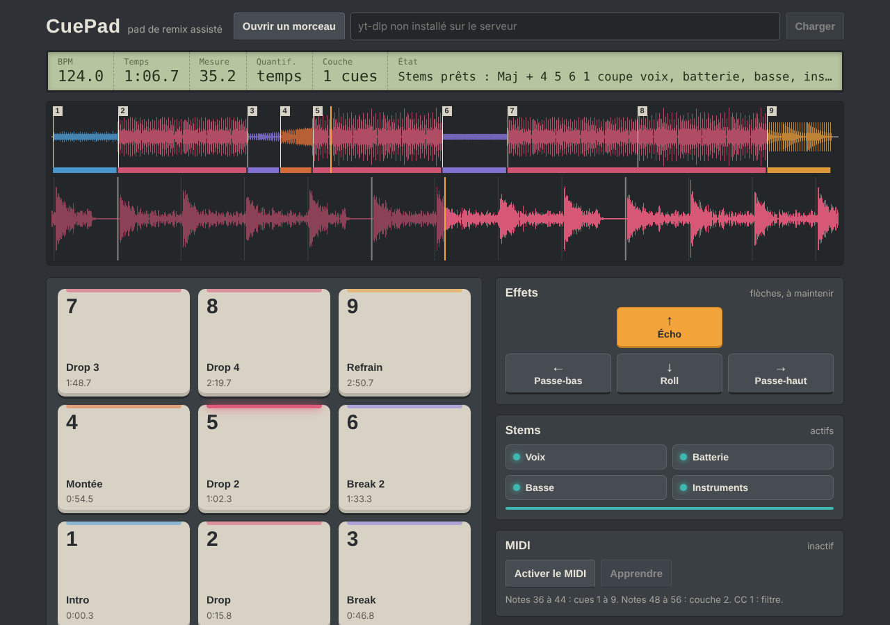

# CuePad

**English** · [Français](README.fr.md)

A remix pad you play with your numeric keypad. Drop in a track, CuePad analyses it (tempo, beats, bars, sections) and places **9 hot cues** on the interesting moments by itself: intro, verses, build-ups, drops, breaks… Then you play it from the keypad, like YouTube's 1–9 keys, but always on beat.



## Features

- **Automatic analysis** right in the browser: BPM, beat grid, downbeats, section detection and naming (Intro, Couplet, Refrain, Montée, Drop, Break, Pont, Outro — the interface is in French).
- **9 hot cues** placed on section and phrase starts, coloured by section type.
- **Quantised jumps**: when you hit a pad, the jump waits for the next beat (or bar), so it always lands on time.
- **Two pad layers**: cues, and with <kbd>Shift</kbd> held, loops and stems.
- **Arrow-key effects** (hold): low-pass, high-pass, tempo-synced echo, roll in "slip" mode (the track resumes where it would have been).
- **Stems** (vocals / drums / bass / instruments) with [Demucs](https://github.com/facebookresearch/demucs), through the local server.
- **YouTube links** with [yt-dlp](https://github.com/yt-dlp/yt-dlp), through the local server.
- **MIDI**: plug in a pad controller; a "learn" mode lets you map your own controls.

## Running CuePad

### Browser only (no stems, no YouTube)

Open `static/index.html` in Chrome, Chromium, Edge or Firefox, then load an MP3, FLAC, WAV, OGG or M4A file.

### With the local server (stems + YouTube)

Requires Python 3.10 or newer.

**1. Install the dependencies**

```bash
python -m pip install -r requirements.txt   # server, yt-dlp and ffmpeg
python -m pip install demucs                # stems (pulls in PyTorch, large download)
```

No separate ffmpeg install needed: if it isn't already on your machine, the server uses the one shipped with the `imageio-ffmpeg` package.

With an NVIDIA GPU, install PyTorch with CUDA first (see [pytorch.org](https://pytorch.org/get-started/locally/)); otherwise Demucs runs on the CPU.

**2. Start**

```bash
python server.py
```

Then open <http://127.0.0.1:8765>. On startup the server lists what is enabled and the command to run for anything missing.

The first separation downloads the Demucs model (about 80 MB). Expect 10–30 s per track on an NVIDIA GPU, a few minutes on CPU. Results are kept in `cache/`, so a track you've already processed reloads instantly.

Settings (environment variables):

| Variable        | Purpose                                         | Default      |
|-----------------|-------------------------------------------------|--------------|
| `CUEPAD_DEVICE` | `cuda` or `cpu` for Demucs                      | automatic    |
| `CUEPAD_MODEL`  | Demucs model (`htdemucs`, `htdemucs_ft`…)       | `htdemucs`   |
| `CUEPAD_CACHE`  | cache folder                                    | `./cache`    |

## Controls

The pads follow the numeric keypad layout:

```
 7  8  9        layer 1: cues 1 to 9 (chronological order)
 4  5  6        layer 2 (Shift held):
 1  2  3          7 8 9  loop 1 beat / 2 beats / 1 bar
                  4 5 6  vocals / drums / bass   (mute / unmute)
                  1      instruments
                  2      acapella (vocals only)
                  3      rhythm (drums + bass)
```

| Key | Action |
|---|---|
| <kbd>1</kbd>–<kbd>9</kbd> (keypad or top row) | jump to cue |
| <kbd>Ctrl</kbd> + <kbd>1</kbd>–<kbd>9</kbd> | set the cue at the current position (snapped to the nearest beat) |
| <kbd>Shift</kbd> + keypad | layer 2 |
| <kbd>+</kbd> (keypad) | lock layer 2 |
| <kbd>←</kbd> <kbd>→</kbd> | low-pass / high-pass filter (hold) |
| <kbd>↑</kbd> | tempo-synced echo (hold) |
| <kbd>↓</kbd> | half-beat roll, slip mode (hold) |
| <kbd>0</kbd> / <kbd>Enter</kbd> / <kbd>Space</kbd> | play / pause |
| <kbd>.</kbd> | back to start |
| <kbd>/</kbd> | quantise: beat → bar → off |
| <kbd>*</kbd> | restore the automatic cues |
| <kbd>Shift</kbd> + <kbd>0</kbd> | reset everything (stems, loops, effects) |

**On Windows**, <kbd>Shift</kbd> + numeric keypad misbehaves (Windows silently releases Shift while NumLock is on). Use keypad <kbd>+</kbd> to lock layer 2 instead, or <kbd>Shift</kbd> + the top-row number keys.

Cues you edit are saved in the browser, per track.

### MIDI

Click "Activer le MIDI" (Chrome, Chromium or Edge). Default mapping: notes 36–44 → cues 1–9, notes 48–56 → layer 2, CC 1 → filter (left low-pass, right high-pass). "Apprendre" (learn): click a pad or an effect, then move a control on your controller.

## How the analysis works

`static/analysis.js`, plain JavaScript, runs in a Web Worker:

1. Mono downmix, decimation to ~22 kHz, short-time Fourier transform (2048 window, 256 hop).
2. Onset curve (log spectral flux); tempo by autocorrelation with a prior around 120 BPM.
3. Beat tracking by dynamic programming (Ellis, 2007), then a regular grid fitted over the whole track when the tempo is constant.
4. Downbeat: the phase that best matches kick drums and chord changes.
5. Per-bar descriptors (chroma, band energies, rhythmic density) → Foote novelty curve → section boundaries aligned to 4- or 8-bar phrases.
6. Similar sections are grouped (A, B, C…) and named from their energy and position in the track.

Tests on synthetic tracks with a known structure:

```bash
node tests/test_analysis.js
```

## Prototype limitations

- Assumes 4/4. Tracks with a drifting tempo (live drummer) use the tracked beats rather than a regular grid, which is less precise.
- Section names are an estimate: "Refrain" and "Drop" can swap depending on the genre.
- YouTube links: personal use only, within YouTube's terms of service.

## License

MIT
